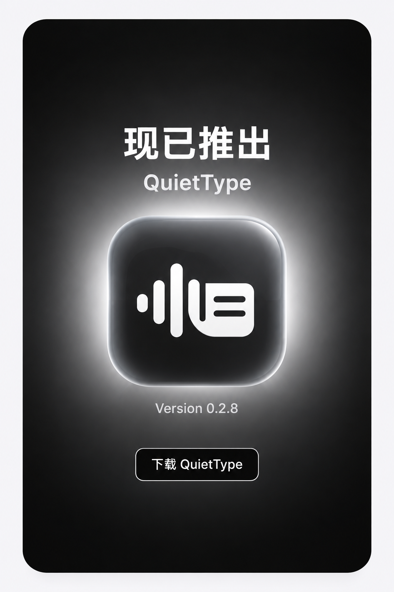

# QuietType

轻声说话，自动整理并填入当前输入框；语音识别和文字整理均在 Mac 本机完成。

  <a href="https://github.com/mlm93098601-ai/quiettype-updates/releases/latest/download/QuietType.zip">
    <picture>
      <source media="(prefers-color-scheme: dark)" srcset="assets/download/quiettype-transparent.png">
      
    </picture>
  </a>
   
  <a href="https://github.com/mlm93098601-ai/quiettype-updates/releases/latest/download/QuietType.zip"><strong>⬇ 下载 QuietType · 最新版</strong></a>

**当前版本：[0.2.8](https://github.com/mlm93098601-ai/quiettype-updates/releases/tag/v0.2.8)** · Apple 芯片（M 系列）· macOS 26 或更高版本

### 下载后怎么用

1. 解压下载的 ZIP，双击 **QuietType**；应用会自动安装到“应用程序”并打开。
2. 按界面提示允许麦克风和辅助功能，Fn / 地球键设为“不执行任何操作”。
3. 首次打开会自动下载、校验和准备本地语音文件，界面显示进度；就绪后按 **Fn** 开始说话，再按 **Fn** 结束。

**无需运行命令、手动下载分段或先装旧版。** 首次语音文件约 6.8 GB，建议预留 30 GB 空间；断网后重新打开或点“重新准备”即可续传，准备好后可以离线使用。

macOS 若阻止首次打开，请到 **系统设置 → 隐私与安全 → 仍要打开** 确认；应用当前沿用固定本地签名，尚未经过 Apple 公证。权限授权需本人确认。不能自动安装到“应用程序”时，可手动拖入后打开。

### 已经安装过

在 **QuietType → 设置 → 软件更新 → 检查更新** 中更新。后续程序更新约 8 MB，复用已有语音文件，保留设置、词库和记录。

首页下载按钮始终指向最新正式版，不需要查找版本号或选择附件。

### 0.2.8 更新

- Fn 按下即请求录音，松开不重复触发；首帧音频到达后播放提示音，改善启动反馈。
- 可选择系统默认、电脑内置或耳机麦克风；来源不可用会明确提示。
- 首次使用检查、失败重试、再次填入、常用词和快捷短语、历史删除及五分钟录音提醒。
- 本地语音模型空闲后释放内存，后续按需加载。

[查看全部版本与更新说明](https://github.com/mlm93098601-ai/quiettype-updates/releases) · [开发与构建说明](DEVELOPMENT.md)

下载和更新需要联网；语音识别与文字整理不上传音频或历史。此仓库不包含用户录音、个人设置、历史、离线模型或签名私钥。

[下载最新源码](https://github.com/mlm93098601-ai/quiettype-updates/releases/latest/download/QuietType-Source.zip)
